# 海克斯麻将

  

> 把一桌川麻，变成一场会随机改变规则的牌局。

海克斯麻将是一个为线下麻将设计的网页辅助工具。它把《英雄联盟》式的“海克斯”规则带到川麻牌桌：每个抽取节点随机翻开一张全桌共享的场地效果，改变接下来这局牌的玩法。

网页负责抽卡、展示、同步和计时；真正的摸牌、出牌、碰杠胡和筹码结算仍在线下完成。你可以把手机或电脑放在牌桌旁，让所有玩家看到同一套规则。

## 目录

- [项目特色](#项目特色)
- [一局牌怎么玩](#一局牌怎么玩)
- [快速开始](#快速开始)
- [账号与私人卡池](#账号与私人卡池)
- [项目结构](#项目结构)
- [开发与测试](#开发与测试)
- [部署提示](#部署提示)
- [功能边界](#功能边界)
- [参与贡献](#参与贡献)
- [文档](#文档)
- [许可证](#许可证)

## 项目特色

### 全桌共享的海克斯

海克斯是场地效果，不属于某一位玩家。房间内任何人抽到卡牌后，所有玩家都会实时看到相同的效果，避免每个人维护一套复杂的个人卡牌。

下面是 12 张代表性海克斯的图鉴卡面截图，涵盖万能牌、换牌、规则改写、限制效果和结算奇迹。点击图片可查看原图。

<table>
  <tr>
    <td width="33%"><a href="docs/images/hexes/p01.png">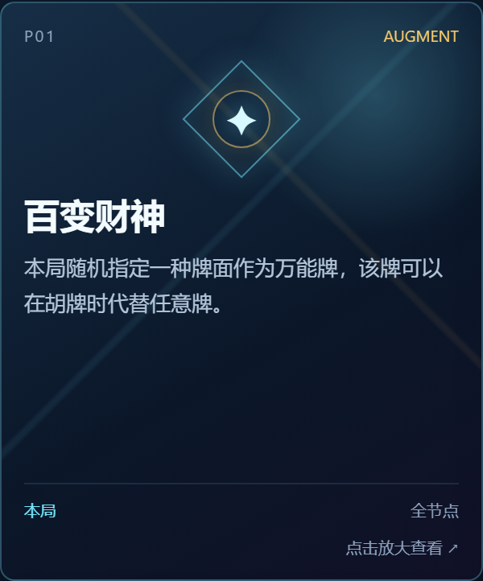</a></td>
    <td width="33%"><a href="docs/images/hexes/p16.png">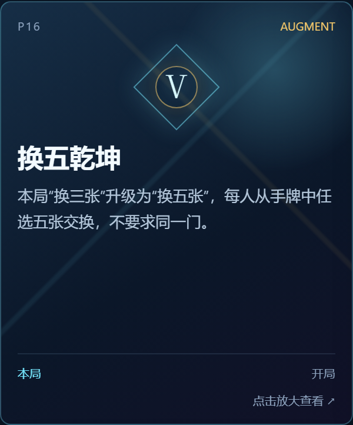</a></td>
    <td width="33%"><a href="docs/images/hexes/p21.png">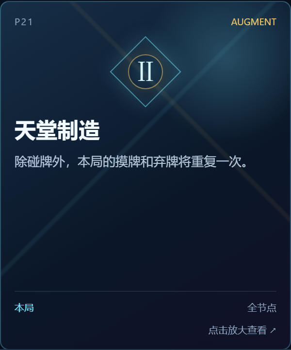</a></td>
  </tr>
  <tr>
    <td width="33%"><a href="docs/images/hexes/p31.png">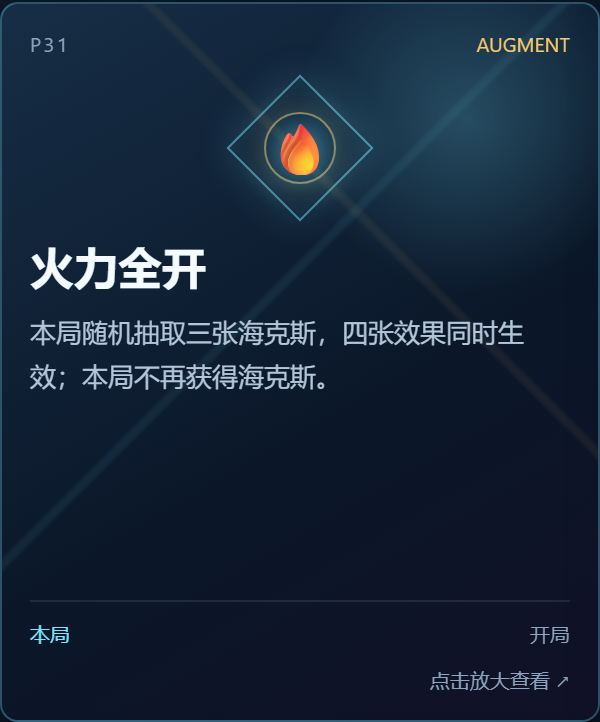</a></td>
    <td width="33%"><a href="docs/images/hexes/p34.png">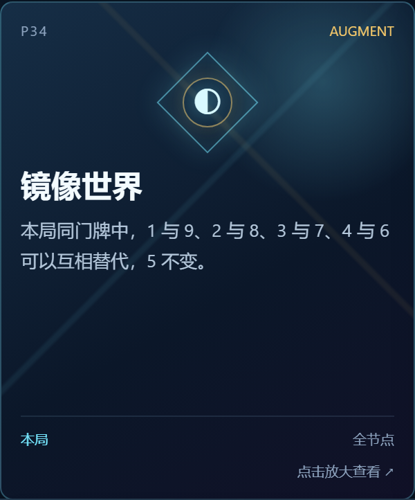</a></td>
    <td width="33%"><a href="docs/images/hexes/p38.png">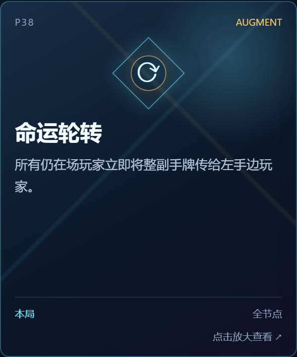</a></td>
  </tr>
  <tr>
    <td width="33%"><a href="docs/images/hexes/n01.png">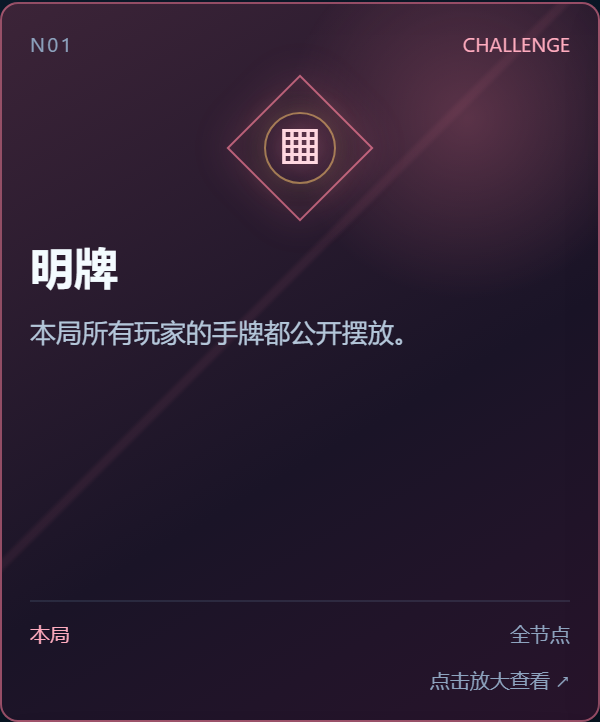</a></td>
    <td width="33%"><a href="docs/images/hexes/n06.png">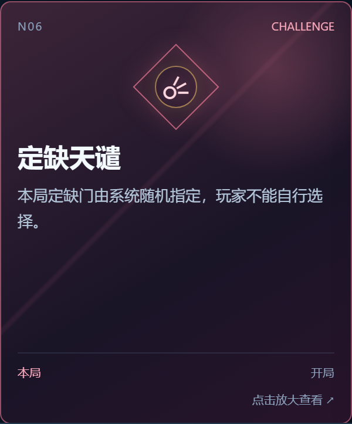</a></td>
    <td width="33%"><a href="docs/images/hexes/r02.png">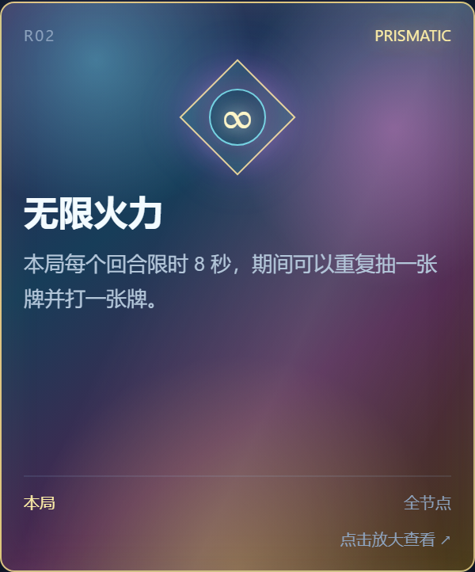</a></td>
  </tr>
  <tr>
    <td width="33%"><a href="docs/images/hexes/r03.png">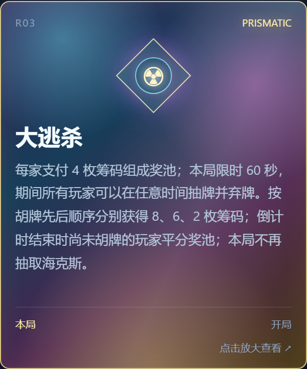</a></td>
    <td width="33%"><a href="docs/images/hexes/r04.png">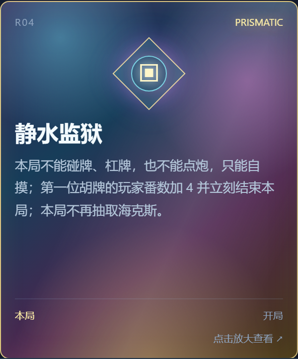</a></td>
    <td width="33%"><a href="docs/images/hexes/r06.png">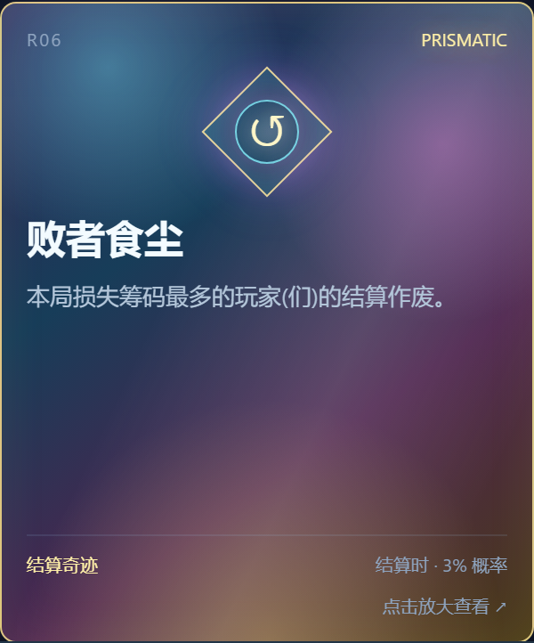</a></td>
  </tr>
</table>

默认官方卡池使用三个抽取节点：

| 节点 | 触发时机 |
| --- | --- |
| 开局 | 换三张之前 |
| 第一家胡牌 | 第一位玩家胡牌并完成线下处理后 |
| 第二家胡牌 | 第二位玩家胡牌并完成线下处理后 |

卡牌通过节点标签筛选。标记为“全节点”的卡可以出现在普通抽取节点；只标记为开局、第一家或第二家的卡只会在对应节点出现。部分规则会锁定后续抽取，网页会同步显示状态。

### 房间实时同步

创建房间后，朋友可以用房间号和密码加入。抽卡、随机牌面揭晓、计时、重置和场地效果都会通过 WebSocket 同步到同一房间。

官方卡池不要求登录。房间最多 4 人；锁屏、断网或关闭页面造成的短暂断连会保留席位一段时间，重新打开页面可以恢复牌局。

### 适合牌桌的移动端界面

大厅、节点进度、场地效果、海克斯图鉴和卡片详情都针对手机屏幕做了布局。需要操作的倒计时卡会提供大尺寸按钮，并支持在卡片详情中查看完整效果。

目前已接入的倒计时海克斯包括：

- **没时间废话了**：每回合 7 秒；
- **无限火力**：每回合 8 秒，可重复摸打一轮；
- **大逃杀**：全局 60 秒。

倒计时状态由房间统一同步，计时音效只在需要时播放，不要求玩家安装额外软件。

### 官方卡池、DIY 卡牌和私人卡池

你可以直接使用官方川麻卡池，也可以注册账号后：

- 制作自己的海克斯卡牌；
- 选择普通、限制或棱彩稀有度；
- 创建 1～5 个自定义抽取节点；
- 混合选择官方卡牌和自己的卡牌；
- 为每张 DIY 卡明确指定它可以出现的节点。

私人卡牌只属于创建者，不会进入公共图鉴。私人卡池进入房间时会被冻结为一份规则快照，因此之后修改卡池不会改变已经开始的牌局。

下面是 DIY 工坊的手机端截图：上方实时预览卡面，下方按分类填写信息；卡池可以自定义抽取节点，并混合选择官方卡牌与自己的海克斯。截图中的卡牌和卡池为演示内容，点击图片可查看原图。

<table>
  <tr>
    <th width="33%">DIY 卡牌 · 实时预览</th>
    <th width="33%">DIY 卡池 · 抽取节点</th>
    <th width="33%">DIY 卡池 · 选择海克斯</th>
  </tr>
  <tr>
    <td><a href="docs/images/studio/diy-card.png">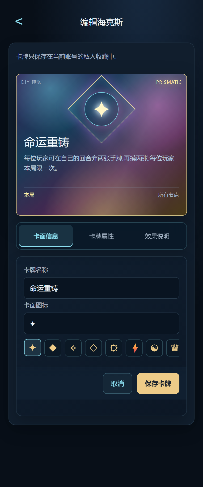</a></td>
    <td><a href="docs/images/studio/diy-pool-nodes.png">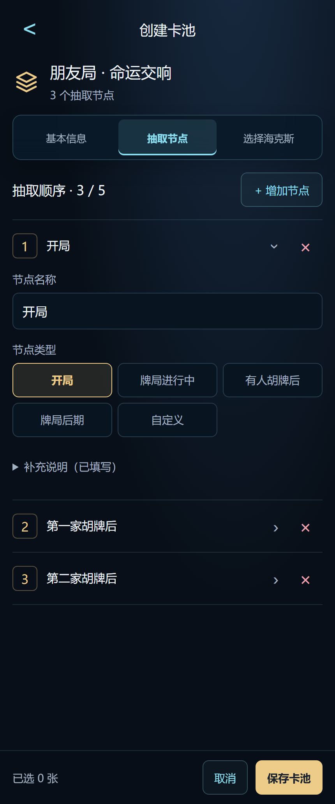</a></td>
    <td><a href="docs/images/studio/diy-pool-cards.png">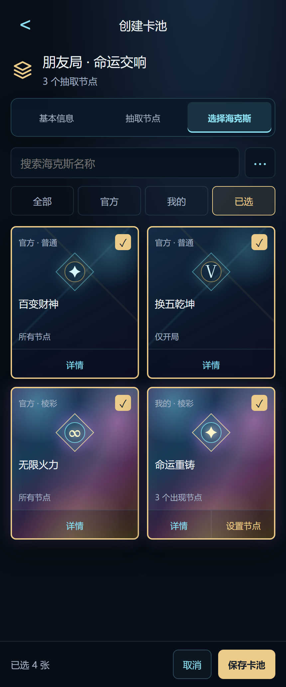</a></td>
  </tr>
</table>

### 结算奇迹与重复率控制

“败者食尘”“灵魂转移”属于结算时判定的特殊海克斯，不会混入三个普通节点的抽卡池。它们在点击结算时由服务器按各自概率统一判定，结果同步给全房间。

同一房间最近三局抽过的卡会暂时降低权重，减少连续几局重复抽到同一张卡，同时保留随机性。

## 一局牌怎么玩

1. 在大厅创建房间，设置 6 位数字密码；或输入房间号和密码加入朋友的房间。
2. 创建房间时选择官方卡池或自己拥有的私人卡池。
3. 在换三张前抽取开局海克斯，并按卡面执行线下规则。
4. 第一位玩家胡牌后，抽取第二个节点海克斯。
5. 第二位玩家胡牌后，抽取第三个节点海克斯。
6. 牌局结束后在线下完成筹码结算，再点击网页中的结算或重置，开始下一局。

建议把手机放在所有人都能看到的位置。海克斯效果以卡面文字和房间当前场地效果为准；遇到需要多人确认的效果，请在牌桌上先约定执行方式再继续游戏。

## 快速开始

### 环境要求

- Node.js 22.16.0 或更高版本；
- npm；
- 浏览器支持 WebSocket 和现代 JavaScript。

### 本地启动

~~~bash
git clone https://github.com/Fishbone23333/Hex_Mahjong.git
cd Hex_Mahjong
npm ci
npm start
~~~

默认只监听本机 127.0.0.1:3000：

- 大厅与牌桌：<http://127.0.0.1:3000/>
- 账号与卡池工坊：<http://127.0.0.1:3000/studio.html>

如果要让同一局域网中的朋友访问，可以临时监听所有网卡：

~~~bash
# macOS / Linux
HOST=0.0.0.0 PORT=3000 npm start
~~~

~~~powershell
# Windows PowerShell
$env:HOST = "0.0.0.0"
$env:PORT = "3000"
npm start
~~~

正式对公网开放时，请使用 HTTPS 反向代理，不要直接把 Node.js 端口暴露给互联网。部署参数和 Nginx 示例见 [deploy/](deploy/)。

## 账号与私人卡池

账号是可选的：

- 不登录也可以创建房间、加入房间并使用官方卡池；
- 登录后才能管理自己的 DIY 卡牌和私人卡池；
- 注册不强制绑定邮箱；
- 绑定邮箱后才可以使用密码找回功能。

在 studio.html 中，推荐按下面的顺序使用：

1. 注册或登录账号；
2. 在“我的海克斯”中制作或编辑卡牌；
3. 在“我的卡池”中创建卡池；
4. 添加 1～5 个节点，填写节点名称和说明；
5. 选择官方卡牌或私人卡牌；
6. 对选中的 DIY 卡牌逐张勾选它可以出现的节点；
7. 保存卡池，然后回到大厅创建房间时选择它。

私人卡池只对所属账号可见和可编辑。进入房间后，房间里的所有玩家都能看到该卡池产生的效果，这是为了让线下牌局能够共同执行规则。

### 邮箱绑定和密码找回

邮箱绑定不是注册必需项。绑定时需要验证当前密码和邮箱验证码；找回密码时，系统会向已验证邮箱发送一次性重置链接。

邮件功能需要在服务器环境中配置 SMTP 参数。未配置完整 SMTP 时，账号登录和官方卡池仍可用，只是绑定邮箱和密码找回会显示为未开放。QQ 邮箱的配置说明见 [deploy/邮箱绑定与找回密码.md](deploy/邮箱绑定与找回密码.md)。

## 项目结构

| 路径 | 作用 |
| --- | --- |
| index.html | 大厅、房间、节点进度、场地效果和海克斯图鉴 |
| studio.html | 登录、个人中心、DIY 卡牌和私人卡池工坊 |
| server.mjs | HTTP 服务、房间状态、WebSocket 同步、抽卡和计时 |
| cards.json | 运行时读取的官方卡牌和节点标签 |
| lib/account-store.mjs | SQLite 账号、会话、私人卡牌和私人卡池数据层 |
| artifacts/ | 闪卡等前端静态资源 |
| scripts/ | 安全、房间、抽卡、计时、结算和账号测试 |
| hex_mahjong_hexes.md | 面向玩家阅读的完整海克斯图鉴 |
| 更新日志.md | 按日期记录的功能和规则变化 |
| deploy/ | 环境变量、Nginx、systemd、备份和恢复示例 |

系统架构可以概括为：

~~~mermaid
flowchart LR
    A[手机或电脑浏览器] -->|HTTP 页面与 API| B[Node.js 服务]
    A <-->|WebSocket 房间同步| B
    B --> C[内存中的房间状态]
    B --> D[(SQLite 账号与私人卡池)]
    B --> E[cards.json 官方卡池]
~~~

## 开发与测试

安装依赖：

~~~bash
npm ci
~~~

启动开发服务：

~~~bash
npm start
~~~

运行完整回归测试：

~~~bash
npm test
~~~

完整测试会覆盖：

- 海克斯节点筛选、冲突和最近三局重复率；
- 火力全开、倒计时和大逃杀；
- 房间创建、加入、恢复、退出和过期；
- 普通结算、败者食尘和灵魂转移；
- 账号、密码、邮箱绑定和私人卡池；
- Cookie、Origin、请求限流、消息大小和资源配额；
- SQLite 备份、恢复和生产配置。

也可以单独运行某一组测试：

~~~bash
npm run test:accounts
npm run test:timer
npm run test:rooms
npm run test:settlement
npm run test:security
npm run test:production
~~~

修改 Markdown 或配置后，可以先执行：

~~~bash
git diff --check
~~~

## 部署提示

生产环境至少需要考虑以下事项：

1. 使用专用低权限服务账号运行 Node.js；
2. 用 Nginx 或其他反向代理提供 HTTPS，并转发 WebSocket；
3. 配置 ALLOWED_ORIGINS、安全 Cookie 和正确的站点路径；
4. 将 SQLite 数据库、WAL 文件和备份目录放在应用发布目录之外；
5. 不提交 .env、数据库、日志、SMTP 授权码、私钥和部署记录；
6. 定期执行 npm run backup，并把备份复制到服务器之外；
7. 给服务、磁盘、证书和备份配置监控；
8. 发布前运行 npm test 和 npm run release:prepare。

常用环境变量包括：

| 变量 | 用途 |
| --- | --- |
| HOST / PORT | 服务监听地址和端口 |
| NODE_ENV | 正式环境使用 production |
| HEX_DB_PATH | SQLite 数据库路径 |
| HEX_BASE_PATH | 站点部署路径与 Cookie 路径 |
| ALLOWED_ORIGINS | 允许的网页来源 |
| SMTP_HOST、SMTP_PORT、SMTP_SECURE | 邮件服务器 |
| SMTP_USER、SMTP_PASS、MAIL_FROM | 发信账号和凭据 |
| MAIL_PUBLIC_BASE_URL | 邮件中的找回密码链接地址 |
| SETTLEMENT_TRIGGER_RATE | 败者食尘触发概率，默认 0.03 |
| SOUL_TRANSFER_TRIGGER_RATE | 灵魂转移触发概率，默认 0.03 |

完整示例见 [deploy/hex-mahjong.env.example](deploy/hex-mahjong.env.example)。部署和恢复步骤见 [deploy/安全部署与恢复.md](deploy/安全部署与恢复.md)。

## 功能边界

海克斯麻将是线下牌局的辅助工具，它不会：

- 识别实体麻将牌；
- 自动判断玩家是否真的完成了碰、杠、听牌或胡牌；
- 自动计算每个人实际应支付的筹码；
- 替代玩家对争议效果作出裁决；
- 将私人卡牌公开到公共图鉴。

它会：

- 保存并同步房间里的海克斯状态；
- 按节点标签和冲突规则筛选候选卡；
- 展示随机牌面、特殊结果和场地效果；
- 为需要计时的效果提供全房间同步计时器；
- 在结算节点按服务器规则统一判定特殊海克斯。

## 参与贡献

欢迎提交 Issue、改进卡牌设计、修正文档或发起 Pull Request。

建议的贡献流程：

1. 从最新 main 创建功能分支；
2. 只提交与当前改动相关的文件；
3. 为业务逻辑补充对应回归测试；
4. 运行 npm test 和 git diff --check；
5. 在 Pull Request 中说明用户场景、实现方式和验证结果。

新增官方海克斯时，请同时检查：

- cards.json 的编号、节点标签、稀有度和冲突元数据；
- index.html 中的展示文案和特殊交互；
- hex_mahjong_hexes.md 与 更新日志.md；
- 是否需要计时器、随机揭晓或结算逻辑；
- 是否会让某些节点无法完成或与已有卡牌冲突。

## 文档

- [海克斯完整图鉴](hex_mahjong_hexes.md)
- [更新日志](更新日志.md)
- [海克斯规则改良计划](海克斯规则改良计划.md)
- [闪卡制作流程与踩坑记录](闪卡制作流程与踩坑记录.md)
- [上线前安全检查与改进计划](上线前安全检查与改进计划.md)
- [安全部署与恢复](deploy/安全部署与恢复.md)
- [邮箱绑定与密码找回](deploy/邮箱绑定与找回密码.md)

## 许可证

本项目采用 [MIT License](LICENSE)。你可以自由使用、修改、分发和部署本项目，包括商业使用，但需要保留版权声明和许可证文本。

仓库中的图片、音效、闪卡资源和第三方工具生成素材可能有独立的授权条件，使用前请确认对应资源的许可范围；项目依赖也分别遵守各自的许可证。
